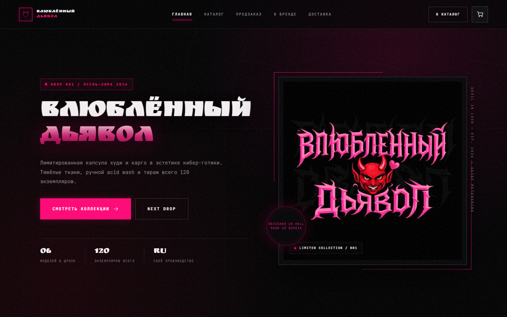

# Андрей Коршунов — Junior Frontend Developer

Портфолио начинающего фронтенд-разработчика. Три сайта, собранные с нуля на HTML, CSS и JavaScript — без конструкторов и фреймворков.

**Живое портфолио:** [https://yazychok.github.io/](https://yazychok.github.io/)  
**Telegram:** [@Barsik_Uchiha](https://t.me/Barsik_Uchiha) · **E-mail:** [barsikuchiha29@gmail.com](mailto:barsikuchiha29@gmail.com) · **GitHub:** [Yazychok](https://github.com/Yazychok)

## Проекты

| Проект | Демо | Код |
| --- | --- | --- |
| Интернет-магазин «Влюблённый Дьявол» — 6 страниц, корзина, оформление заказа, фильтры | [https://yazychok.github.io/shop/](https://yazychok.github.io/shop/) | [shop](https://github.com/Yazychok/Yazychok.github.io/tree/main/shop) |
| Одностраничный лендинг — корзина, модальные окна, front/back, localStorage | [https://yazychok.github.io/one/](https://yazychok.github.io/one/) | [one](https://github.com/Yazychok/Yazychok.github.io/tree/main/one) |
| Бренд-визитка — якоря, фильтр, таймер, форма заявки | [https://yazychok.github.io/visitka/](https://yazychok.github.io/visitka/) | [visitka](https://github.com/Yazychok/Yazychok.github.io/tree/main/visitka) |

## Стек

- **HTML5** — семантическая вёрстка, формы, доступность
- **CSS3** — Flexbox, Grid, переменные, анимации, адаптив
- **JavaScript** — DOM, события, localStorage, корзина, фильтры, модальные окна
- **Git / GitHub / GitHub Pages** — версии и публикация

## О репозитории

Это pet-проекты, а не коммерческая работа. Коммерческого опыта пока нет — зато есть три законченных сайта, открытый код и готовность к тестовому заданию. Ищу первую работу, стажировку или junior-позицию.

- Портфолио: [https://yazychok.github.io/](https://yazychok.github.io/)
- Резюме: [PDF](https://yazychok.github.io/resume.pdf) · [HTML](https://yazychok.github.io/resume.html)
